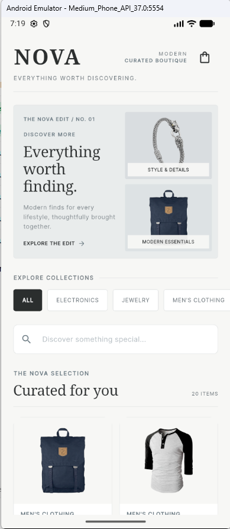
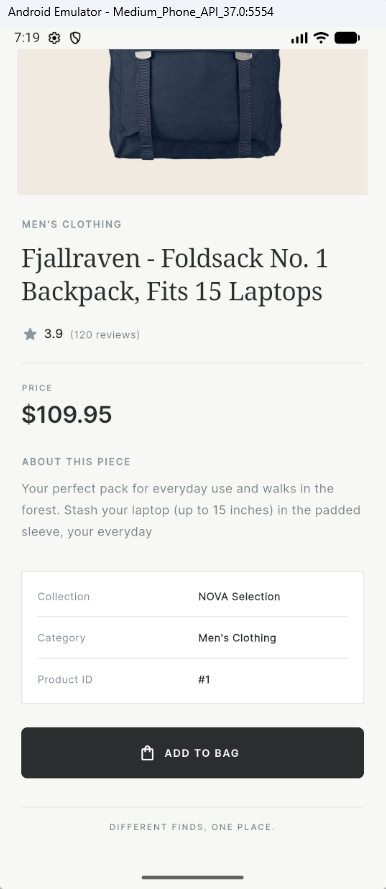
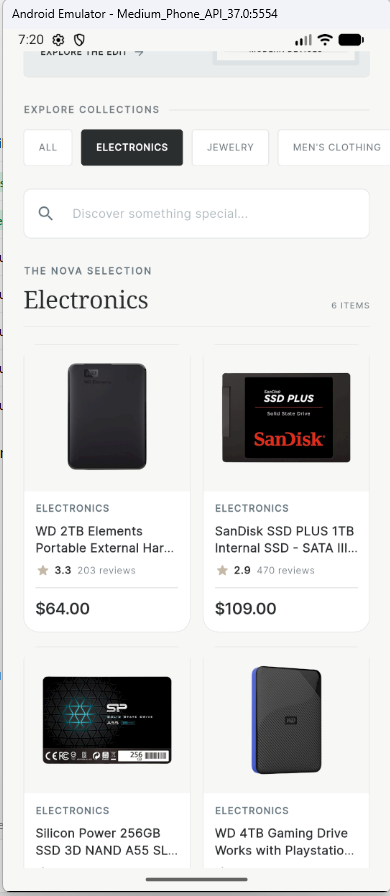
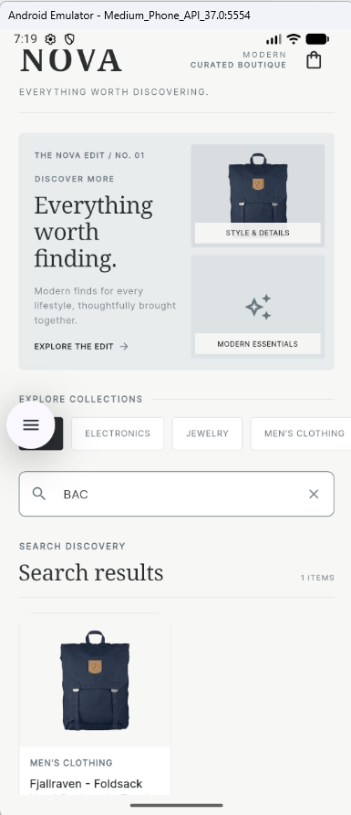
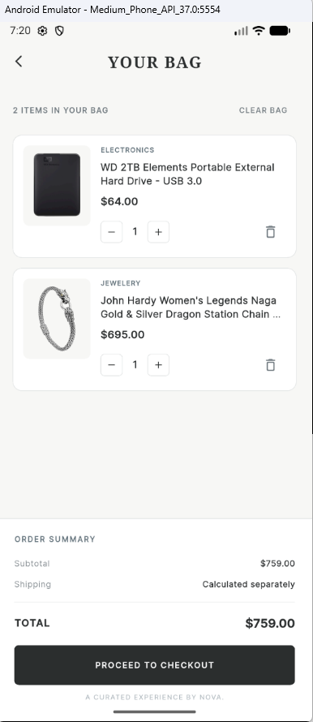

# NOVA — Modern Curated Boutique

NOVA is a product catalog application built with Flutter. It allows users to browse products, search by name, filter products by category, and view product details. The app also includes a simple shopping cart where users can manage the products they want to add.

Product information is retrieved from the Fake Store API.

## Features

- **Product Catalog** – Displays products with their images, names, prices, categories, and ratings.
- **Product Details** – Shows product information, including its description and rating.
- **Search** – Allows users to find products by name.
- **Category Filter** – Filters the product list based on the selected category.
- **Shopping Cart** – Allows users to add products, update quantities, and remove items.
- **Network Error Handling** – Displays an error message when a request fails or the internet connection is unavailable.
- **Retry** – Allows users to retry loading products after a connection problem.
- **Image Handling** – Shows a loading indicator while images are loading and a fallback icon if an image fails to load.

## Built With

| Technology | Usage |
|---|---|
| Flutter | Application framework |
| Dart | Programming language |
| Provider | State management |
| HTTP | API requests |
| Google Fonts | Application typography |
| Fake Store API | Product data |

## Project Structure

The project is organized by feature to keep the code separated and easier to maintain.

text
lib/
├── main.dart
│
├── core/
│   └── theme/
│       └── app_theme.dart
│
└── features/
    ├── cart/
    │   ├── data/
    │   │   └── models/
    │   │       └── cart_item.dart
    │   └── presentation/
    │       ├── pages/
    │       │   └── cart_page.dart
    │       ├── state/
    │       │   └── cart_provider.dart
    │       └── widgets/
    │           └── cart_item_card.dart
    │
    └── products/
        ├── data/
        │   ├── models/
        │   │   └── product_model.dart
        │   ├── repositories/
        │   │   └── product_repository.dart
        │   └── sources/
        │       └── product_api_service.dart
        │
        ├── domain/
        │
        └── presentation/
            ├── pages/
            │   ├── product_catalog_page.dart
            │   └── product_detail_page.dart
            ├── state/
            │   └── product_provider.dart
            └── widgets/
                └── product_card.dart

### Architecture Overview

- **Core** contains shared application settings and theme configuration.
- **Data** handles product models, API communication, repository logic, and cart item data.
- **Presentation** contains the screens, reusable widgets, and Provider classes used to manage application state.
- **Domain** is reserved for business logic if it is needed in future development.

## API Integration

Product data is provided by [Fake Store API](https://fakestoreapi.com/).

The application uses the following endpoints:

| Endpoint | Description |
|---|---|
| `GET /products` | Retrieves all products |
| `GET /products/categories` | Retrieves available categories |
| `GET /products/category/{category}` | Retrieves products by category |

### Product Details

The product detail page uses the product data already retrieved by the catalog page. The selected product is passed to the detail page, so a separate API request is not made when opening a product.

### Search and Filtering

Search is performed locally using the product data already loaded into the application. Category selection is managed through Provider.

## Shopping Cart

The shopping cart is managed locally using Provider. Users can add products, change quantities, remove individual items, and view the subtotal.

Cart data is stored in memory and will be cleared when the application is restarted. The checkout button is included for demonstration purposes only and is not connected to a payment service or backend.

## Getting Started

### Requirements

- Flutter SDK
- Dart SDK
- Android Studio or Visual Studio Code
- Android Emulator or a physical Android device
- Internet connection

### Installation

1. Clone the repository:

bash
git clone https://github.com/viandranamiraanjani-hash/mosaic-product-catalog.git

2. Open the project directory:

bash
cd product_catalog

3. Install the dependencies:

bash
flutter pub get

4. Run the application:

bash
flutter run

## Dependencies

The main packages used in this project are:

- `provider: ^6.1.5+1`
- `http: ^1.6.0`
- `google_fonts: 6.3.3`

## Code Analysis and Testing

To check the project for potential issues:

bash
flutter analyze

To run the available automated tests:

bash
flutter test

## Screenshots

### Homepage

### Product Detail

### Category Filter

### Search

### Shopping Cart

## Project Information

| Item | Details |
|---|---|
| Application | NOVA |
| Type | Product Catalog Application |
| Framework | Flutter |
| Language | Dart |
| API | Fake Store API |
| State Management | Provider |

